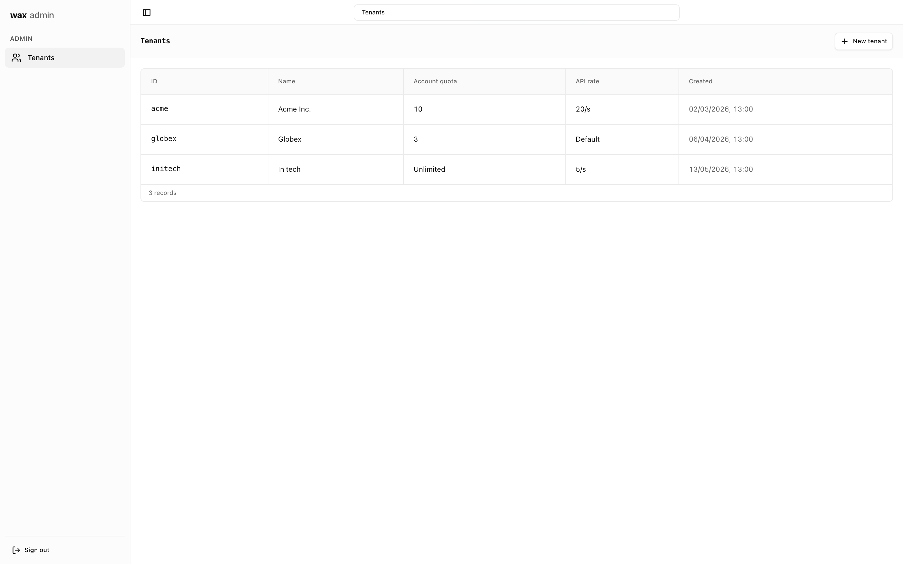
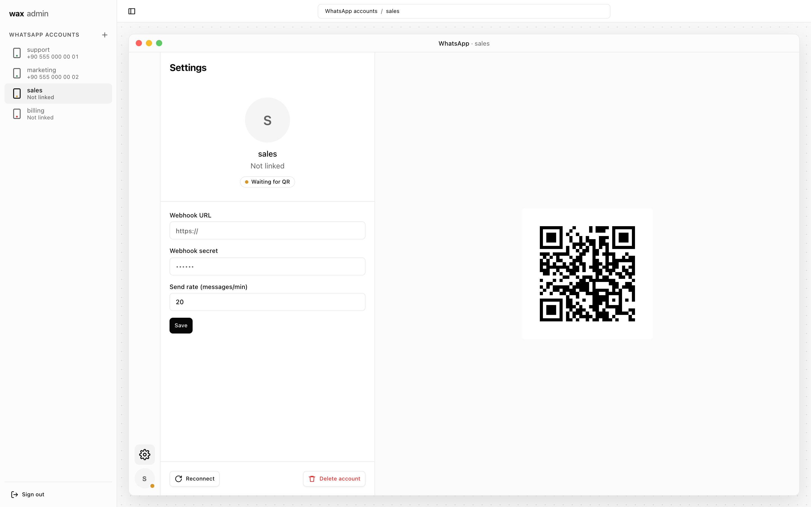
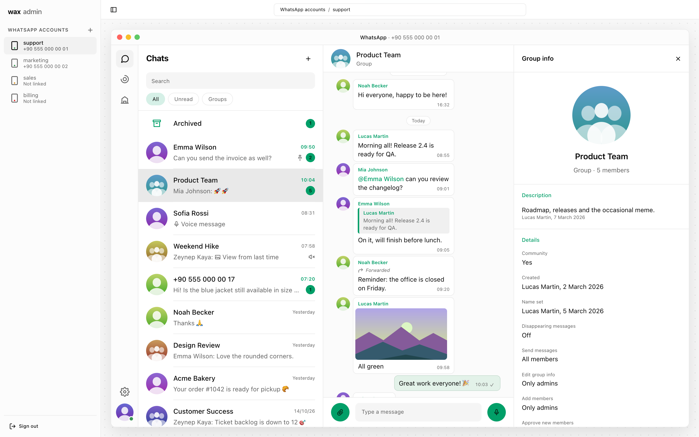
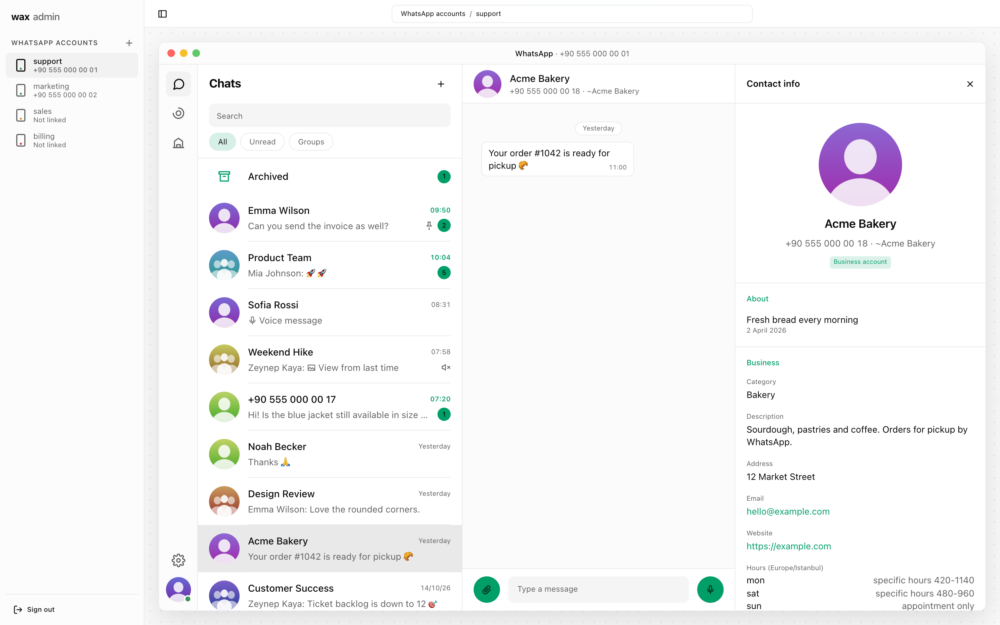
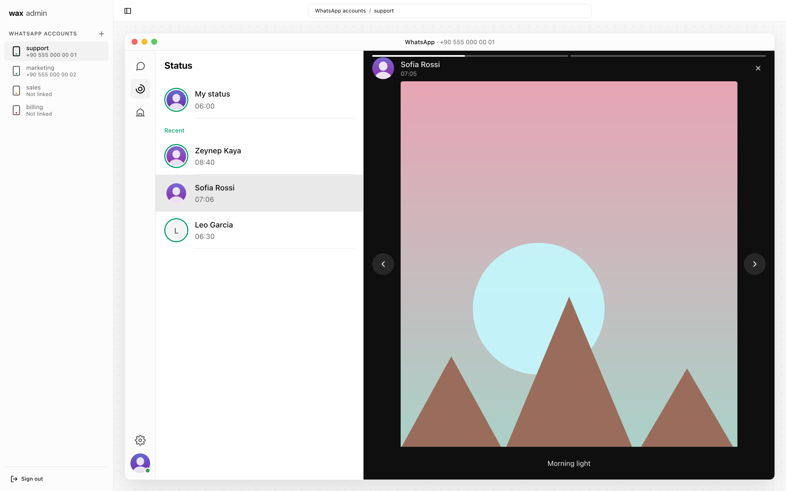
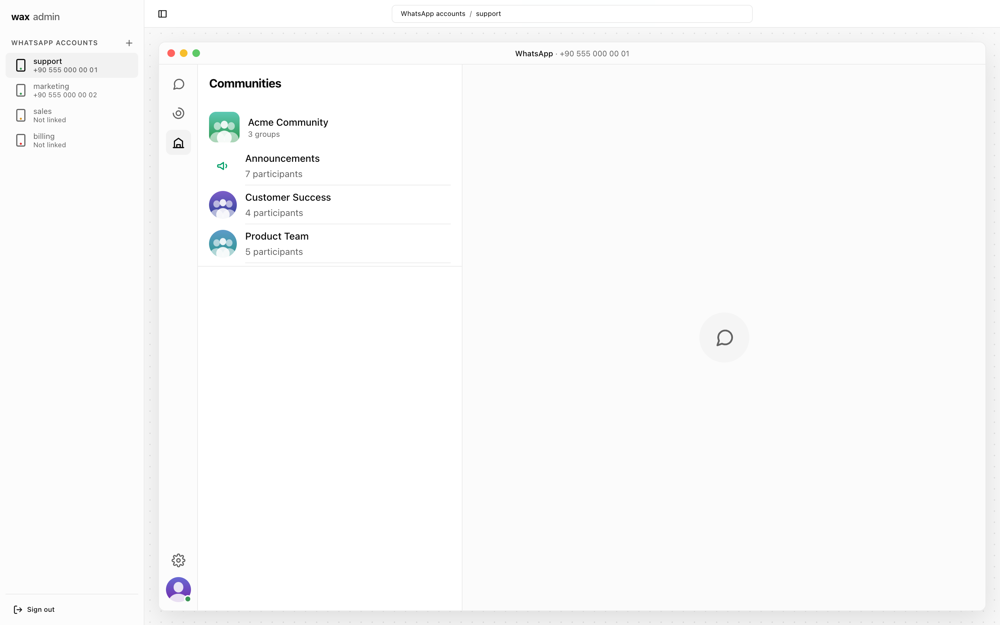

# Admin interface

Every `wax serve` node includes **wax admin**, a small web interface for
managing tenants and working with WhatsApp accounts. It is embedded in the
binary (plain HTML, CSS and JavaScript, no build step) and uses the same
REST API as any other client, with the key you sign in with.

Open `http://<listen>/` in a browser, for example <http://localhost:8080/>.
It redirects to `/ui/`.

The screenshots on this page use made-up data from the demo server (see
[Trying it without WhatsApp](#trying-it-without-whatsapp)).

<picture>
  <source media="(prefers-color-scheme: dark)" srcset="../images/chat-dark.png">
  
</picture>

## Signing in

The sign-in form takes an API key and detects which kind it is:

- **Admin key** (`WAX_API_KEY`): manage **tenants**. Create a tenant (id,
  name, account quota, API rate), edit its limits, delete it, and issue or
  revoke its API keys. A new key is shown once, with a copy button.
- **Tenant key** (`wax_<id>_<secret>`): work with that tenant's **WhatsApp
  accounts** (instances).

The admin key cannot open accounts and a tenant key cannot manage tenants,
exactly as in the API.

<picture>
  <source media="(prefers-color-scheme: dark)" srcset="../images/tenants-dark.png">
  
</picture>

## Accounts

With a tenant key, the sidebar lists the accounts under "WhatsApp
accounts", each with its name, phone number (or "Not linked") and a status
color: green when connected, amber while pairing or connecting, red on
failure. The list refreshes on its own.

**Add WhatsApp account** asks for a name and opens the new account, which
shows the QR code. Scan it from the phone (Settings, Linked devices, Link a
device); the code refreshes while it rotates, and the page switches to the
chats once the phone is linked.

<picture>
  <source media="(prefers-color-scheme: dark)" srcset="../images/pairing-dark.png">
  
</picture>

Each account opens as a WhatsApp Desktop-like window with a rail on the left:

- **Chats:** a resizable chat list with search, filters (All, Unread,
  Groups), pinned chats, the archive, unread counts, previews of the last
  message and profile pictures. Start a new chat by phone number.
  Conversations show text, inline images and videos, playable voice
  messages, documents, replies with the quoted message, mentions,
  forwarded markers, view once markers and system messages.
- **Sending:** type a message, reply to a message, mention group members,
  forward a message to another chat. Attach photos, videos, documents and
  audio with the attach button, by pasting or by drag and drop, add a
  caption, and send. With nothing typed, the send button records a voice
  message in the browser (WebM recordings are converted to Ogg Opus on the
  server).
- **Contact and group info:** names (address book, `~push name`,
  `@username`), number and LID, about text, devices, business profile,
  groups in common and shared media by type. For groups: description,
  settings (who can send and edit, member approval, disappearing messages),
  the community it belongs to and the member list with admins.
- **Status:** status updates of the last 24 hours, yours and your
  contacts'.
- **Communities:** the communities the account is in, with their groups.
- **Settings:** the account's profile and status, its webhook URL and
  secret, its send rate (messages per minute), **Reconnect** and **Delete
  account** (unlinks the device and deletes its data).

People are shown the way WhatsApp shows them: the address book name if
there is one, otherwise the number, `~push name` or `@username`. A
contact's phone-number chat and LID chat are merged into one.

| Group with info pane | Business contact |
|---|---|
| <picture>   <source media="(prefers-color-scheme: dark)" srcset="../images/group-dark.png">    </picture>  | <picture>   <source media="(prefers-color-scheme: dark)" srcset="../images/contact-dark.png">    </picture>  |
| **Status** | **Communities** |
| <picture>   <source media="(prefers-color-scheme: dark)" srcset="../images/status-dark.png">    </picture>  | <picture>   <source media="(prefers-color-scheme: dark)" srcset="../images/communities-dark.png">    </picture>  |

## Trying it without WhatsApp

`cmd/wax-demo` serves the interface with made-up people, groups, a
community, status updates and media, without a WhatsApp connection or a
database. It is useful for trying the interface and for working on it:

```bash
go run ./cmd/wax-demo          # http://127.0.0.1:8090
```

Sign in with any key for the tenant view, or with `admin` for the admin
view. Nothing is sent anywhere; sent text messages only appear in the page
until the demo stops.

The screenshots in `docs/images` are taken from the demo with headless
Chrome:

```bash
node scripts/screenshots.mjs   # with the demo running
```

## Security

- **The key stays in the tab.** It is kept in `sessionStorage`, so it is
  gone when the tab closes, and it is sent only to the same origin as the
  `Authorization` header. Media, QR codes and pictures are fetched with the
  key and shown as local blobs, so the key never appears in a URL.
- **Strict Content Security Policy.** The interface allows only its own
  scripts and styles: no inline scripts, no third-party code, no framing,
  no form submissions elsewhere. It also sends `X-Frame-Options: DENY`,
  `X-Content-Type-Options: nosniff` and `Referrer-Policy: no-referrer`.
- **Text only.** Everything that comes from the server (message text,
  names, captions) is inserted as text, never as HTML, so a message cannot
  inject markup or scripts into the page.

The interface is served over the same address as the API. For use beyond
localhost, put TLS in front of wax as you would for the API.
